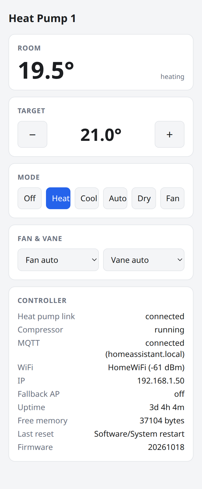
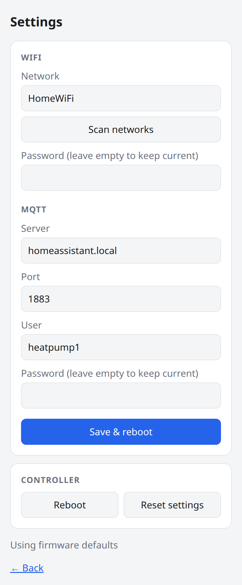

# MitsuCon
Mitsubishi Heat Pump (Air Conditioner) Controller for Home Assistant

*New version with hvac_action. Plase increase PubSubClient.h MQTT_MAX_PACKET_SIZE to 2048.


Build ESP-8266 device to interface between Mitsubishi Electric heat pump and Home Assistant. This code utilizes Home Assistant native MQTT HVAC component with MQTT discovery feature so it should be compatible with future Home Assistant updates and will be added to Home Assistant automatically without any configuration.

## Hardware
The easiest way to buid a controller is to use Wemos D1 mini board since it already has 5V pin. Only board V2 is working out of box, not current board V3. Notice the big shield on board when you place order.


A connector to CN105 port on heat pump is JST PAP-05V-S.

## Build a code
Using Arduino IDE to modify configuration and complie file for your hardware.

Arduino IDE 1.8.10
ArduinoJson 6.12.0
PubSubClient 2.7.0

Edit file Arduino\libraries\PubSubClient\PubSubClient.h MQTT_MAX_PACKET_SIZE to 2048.

Optionally copy `mitsucon/secrets.example.h` to `mitsucon/secrets.h` to pre-fill WiFi, MQTT and OTA settings at build time. Without it the firmware still builds, and settings are entered on the web interface after the first boot (see below). Without `secrets.h` the OTA and firmware upload password is `mitsucon`; set your own `OTA_PASSWORD` in `secrets.h`. The unit number selects hostname and MQTT topic (`heatpump0`, `heatpump1`, ...):

```
arduino-cli compile --fqbn esp8266:esp8266:d1_mini:eesz=4M2M --build-property "build.extra_flags=-DHP_ID=1" --build-path build/hp1 mitsucon
python3 ~/.arduino15/packages/esp8266/hardware/esp8266/3.1.2/tools/espota.py -i heatpump1.lan -p 8266 -a OTA_PASSWORD -f build/hp1/mitsucon.ino.bin
```

## Web interface
Each controller serves a status/control page at `http://<controller>/`. Settings (WiFi, MQTT) and reboot at `/config` are open; firmware upload (`/update`) requires user `admin` with the OTA password.

 

Thermostat limits advertised to Home Assistant default to 16–31 °C in 1° steps; override `MIN_TEMP`, `MAX_TEMP` and `TEMP_STEP` in `secrets.h` to match your remote control.

If no WiFi is configured, or the configured WiFi is unreachable for 60 seconds, the controller opens an open access point `MitsuCon-heatpump<N>`. Join it and browse to `http://192.168.4.1/config` to enter new credentials; the controller saves them and reboots. It keeps retrying the old network while nobody is connected to the access point, and closes the access point once it reconnects.

Tested on Wemos D1 mini board with Home Assistant 0.96 and Mosquitto broker add-on 5.0.

## Known Issues
* Sometimes heat pump unit turns off instead when send temperature changing command.
* When change setting on HA UI, change will effect immediately but UI will delay for next data pull to refresh new status.
* Cannot use imperial (fahrenheit) unit. Waiting for Home Assistant support soon.

## Classic Code
The Classic folder is a code proven to working well on Home Assistant < 0.100.0. It has 2 parts:

* arduino sketch for ESP8266/ESP32 board
* Home Assistant custom component file to place in Home Assistant server

Chris Davis has a very detailed instruction blog:

https://chrdavis.github.io/hacking-a-mitsubishi-heat-pump-Part-1/

https://chrdavis.github.io/hacking-a-mitsubishi-heat-pump-Part-2/

## Other Projects
Interesting projects developed with different design choices: 

WiFi manager and web interface
https://github.com/gysmo38/mitsubishi2MQTT

Enhanced WiFi manager, web interface and mroe functions
https://github.com/dzungpv/mitsubishi2MQTT

Added Platform IO, Added SSL, Added an RGB LED
https://github.com/SittingDuc/MitsuCon


## Credits
Thanks to all contributors especially:
* lekobob https://github.com/lekobob/mitsu_mqtt
* SwiCago https://github.com/SwiCago/HeatPump
* Hadley  https://nicegear.co.nz/blog/hacking-a-mitsubishi-heat-pump-air-conditioner/

*Mitsubishi means Mitsubishi Electric, not Mitsubishi Heavy Industries.
